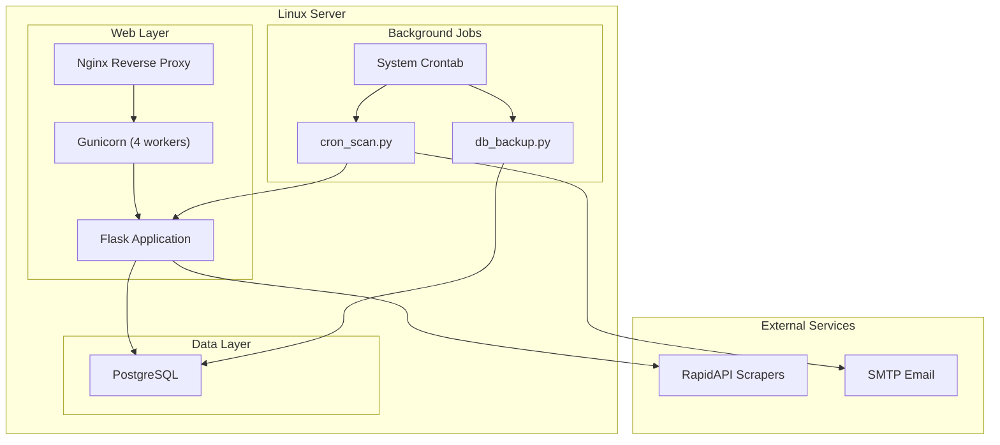
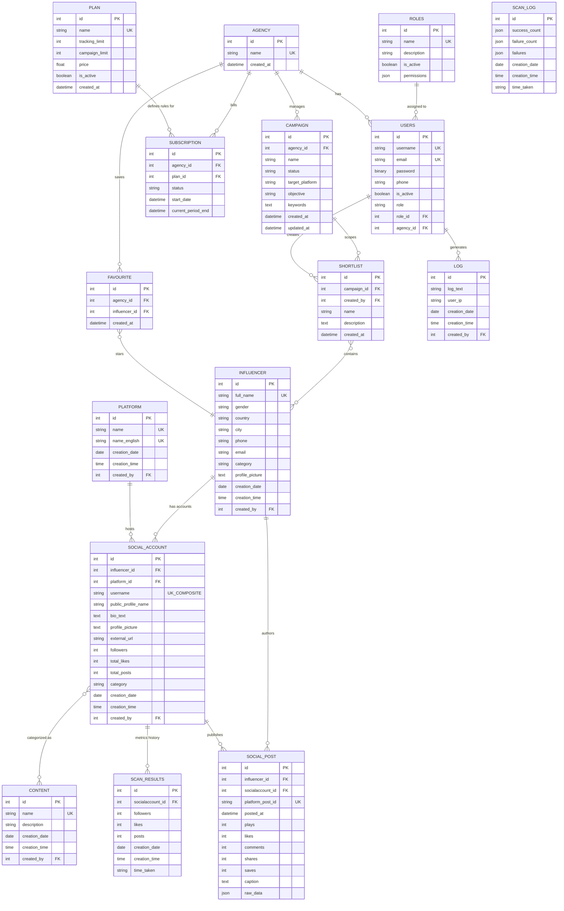
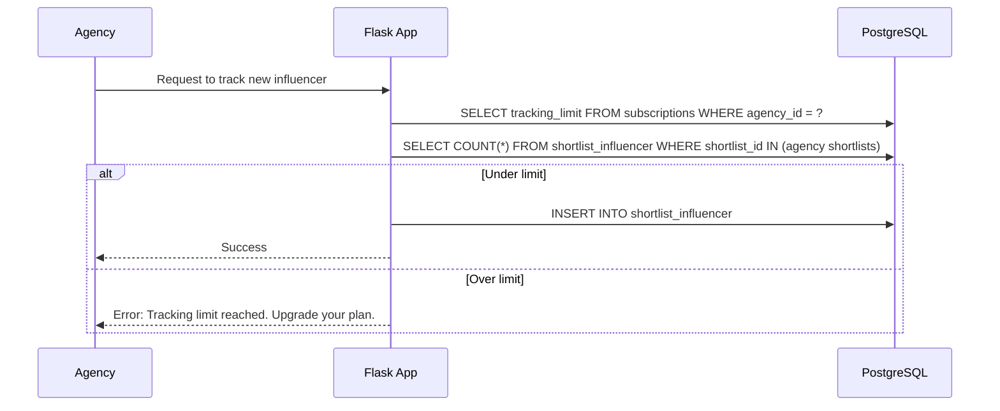
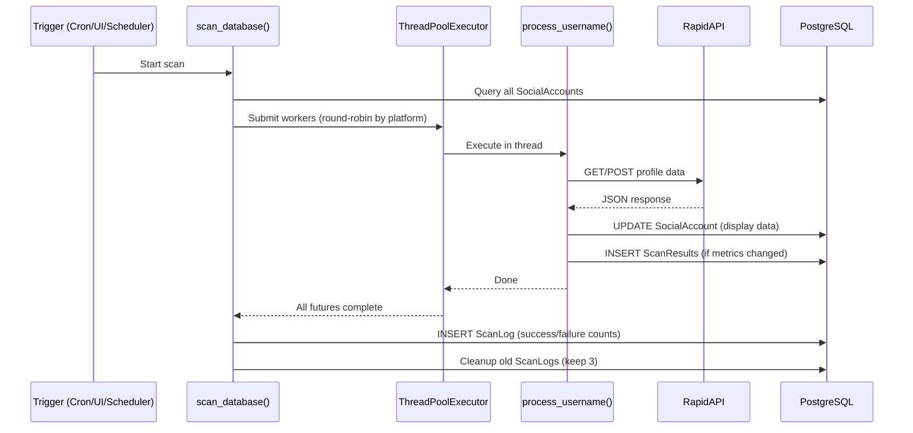

# System Architecture — Influencers Analytics Platform

## Architecture Overview

The platform is a **Flask monolith** deployed on a **Linux server** with **Gunicorn**, backed by **PostgreSQL**. It scrapes social media profiles via RapidAPI third-party endpoints, stores time-series analytics, and exposes a web dashboard for influencer discovery and campaign management.

---

## Database Schema (ER Diagram)

---

### Comprehensive Data Dictionary

| Table Name | Description | Key Fields & Constraints | Relationships |
|---|---|---|---|
| **`roles`** | Custom RBAC role definitions with granular JSON permissions matrix. | `id` (PK), `name` (UK), `is_active`, `permissions` (JSON) | Has many `Users` (`role_id`) |
| **`Users`** | Authenticated platform users (admins, employee users, agency client users). | `id` (PK), `username` (UK), `email` (UK), `role_id` (FK), `agency_id` (FK), `is_active`, `phone` | Belongs to `Agency`, `Role`. Has many `Log` |
| **`agencies`** | Paying tenant organizations in multi-tenant SaaS architecture. | `id` (PK), `name` (UK), `created_at` | Has many `Users`, `Subscription`, `Campaign`, `Favourite` |
| **`plans`** | Subscription tier definitions (limits, pricing). | `id` (PK), `name` (UK), `tracking_limit`, `campaign_limit`, `price`, `is_active` | Has many `Subscription` |
| **`subscriptions`** | Active billing status and cycle dates for an agency. | `id` (PK), `agency_id` (FK), `plan_id` (FK), `status`, `current_period_end` | Belongs to `Agency`, `Plan` |
| **`campaigns`** | Multi-campaign container for influencers and agency objectives. | `id` (PK), `agency_id` (FK), `name`, `status`, `target_platform`, `objective`, `keywords` | Belongs to `Agency`. Has many `Shortlist` |
| **`shortlists`** | Saved collections of influencers scoped to a specific campaign. | `id` (PK), `campaign_id` (FK), `created_by` (FK), `name`, `description` | Belongs to `Campaign`, `Users`. Many-to-Many with `Influencer` |
| **`shortlist_influencer`** | Junction table for `shortlists` and `influencers`. | `shortlist_id` (PK, FK), `influencer_id` (PK, FK) | Cascade deletes on shortlist or influencer deletion |
| **`favourites`** | Globally saved favourite influencers per agency independent of campaigns. | `id` (PK), `agency_id` (FK), `influencer_id` (FK) | Belongs to `Agency`, `Influencer` |
| **`influencers`** | Global database of social media influencer entities. | `id` (PK), `full_name` (UK), `gender`, `country`, `city`, `phone`, `email`, `profile_picture` | Has many `SocialAccount`, `SocialPost`, `Favourite`. M2M `Shortlist` |
| **`platforms`** | Supported social media channels (TikTok, Instagram, Snapchat). | `id` (PK), `name` (UK), `name_english` (UK) | Has many `SocialAccount` |
| **`socialaccounts`** | Platform-specific profiles belonging to an influencer. | `id` (PK), `influencer_id` (FK), `platform_id` (FK), `username`, Unique(`username`, `platform_id`), `followers`, `total_likes`, `total_posts`, `category` | Belongs to `Influencer`, `Platform`. Has many `SocialPost`, `ScanResults`. M2M `Content` |
| **`socialaccount_content`** | Junction table for `socialaccounts` and `contents`. | `socialaccount_id` (PK, FK), `content_id` (PK, FK) | Categorizes social accounts by niche/content type |
| **`social_posts`** | Individual scraped posts for deep analytics & engagement calculations. | `id` (PK), `influencer_id` (FK), `socialaccount_id` (FK), `platform_post_id` (UK), `plays`, `likes`, `comments`, `shares`, `saves`, `raw_data` (JSON) | Belongs to `Influencer`, `SocialAccount` |
| **`contents`** | Niche & content category tags (e.g. Fashion, Tech, Gaming). | `id` (PK), `name` (UK), `description` | M2M `SocialAccount` |
| **`scanresults`** | Time-series historical snapshot of followers, likes, and post counts. | `id` (PK), `socialaccount_id` (FK), `followers`, `likes`, `posts`, `creation_date`, `time_taken` | Belongs to `SocialAccount` |
| **`scanlog`** | Execution audit trail for background cron scraper batches. | `id` (PK), `success_count` (JSON), `failure_count` (JSON), `failures` (JSON), `creation_date` | Scraper job audit log |
| **`log`** | User action audit log (auth, exports, edits). | `id` (PK), `log_text`, `user_ip`, `created_by` (FK), `creation_date` | Belongs to `Users` |

---

## SaaS Multi-Tenancy Architecture

The platform uses an **Agency-based multi-tenancy** model:

| Layer | Table | Purpose |
|---|---|---|
| **Tenant** | `agencies` | Represents a paying company/agency |
| **Identity** | `Users` | Each user belongs to exactly one agency via `agency_id` |
| **Billing** | `subscriptions` | Tracks plan tier, tracking limits, and billing status |
| **Campaigns** | `shortlists` | Agencies save influencer selections for campaign planning |
| **Data Isolation** | All queries | Filter by `agency_id` to prevent cross-tenant data leakage |

### Subscription Enforcement Flow

---

## Scraping Pipeline

---

## Calculated Metrics & KPIs

The platform computes several key performance indicators (KPIs) and metrics for both system administration and influencer analytics.

### System & Admin KPIs
| Metric | Calculation Method | Purpose |
|---|---|---|
| **Total API Calls / Scans** | `sum(ScanLog.success_count) + sum(ScanLog.failure_count)` for a given date range. | Tracks total usage against third-party RapidAPI limits. |
| **Scraper Success Rate** | `(Total Successful Scans / Total API Calls) * 100` | Monitors the health and reliability of background cron scrapers and external APIs. |
| **Quota Used (Influencers)** | Count of unique `influencer_id` values across all `Shortlist` records belonging to an `Agency`'s Campaigns. | Validates if a tenant (Agency) is within their Subscription `tracking_limit`. |
| **Platform Distribution** | Grouping and counting `SocialAccount` records by `platform_id`. | Shows which social media platforms dominate the database. |

### Influencer Profile Metrics
These metrics are calculated dynamically for SaaS users when viewing an Influencer's profile (`influencer_detail` route) based on the latest scraped data:

| Metric | Calculation Method | Purpose |
|---|---|---|
| **Followers / Total Likes** | Directly mapped and stored in `SocialAccount` during scraping (`profile_data['followers_count']`). | Provides top-level account popularity. |
| **Average Views** | `sum(plays) / count(plays)` across all valid `SocialPost` records linked to the account. | Estimates reach of a typical post. |
| **Average Likes** | `sum(likes) / count(likes)` across all valid `SocialPost` records. | Evaluates direct content appreciation. |
| **Average Comments** | `sum(comments) / count(comments)` across all valid `SocialPost` records. | Evaluates conversational engagement. |
| **Average Interactions** | `Average Likes + Average Comments` | A unified metric representing active user interaction with the influencer's recent content. |

---

## Deployment Architecture

### Previous (Render.com)
- Web service + Cron service + Managed PostgreSQL
- Configured via `render.yaml`

### Current (Linux Server)
- **Web**: `systemd` service running Gunicorn → see `deploy/socialscannerw.service`
- **Cron Jobs**: System crontab → see `deploy/crontab`
  - Scan: Every 2 days at 06:00 AM
  - Backup: Daily at 03:00 AM
  - Log rotation: Weekly
- **Database**: Self-managed PostgreSQL
- **Reverse Proxy**: Nginx (recommended, not included in repo)

---

## Key File Reference

| File | Purpose |
|---|---|
| `run.py` | Dev entry point with APScheduler |
| `wsgi.py` | Production WSGI entry point |
| `tasks.py` | Background scanning engine |
| `cron_scan.py` | Standalone cron job for scans |
| `db_backup.py` | PostgreSQL backup via pg_dump |
| `email_utils.py` | SMTP notifications |
| `apps/config.py` | Flask configuration |
| `apps/home/util.py` | Platform scraper functions |
| `apps/saas/models.py` | SaaS tenant models |
| `.agents/AGENTS.md` | Agent reference documentation |
